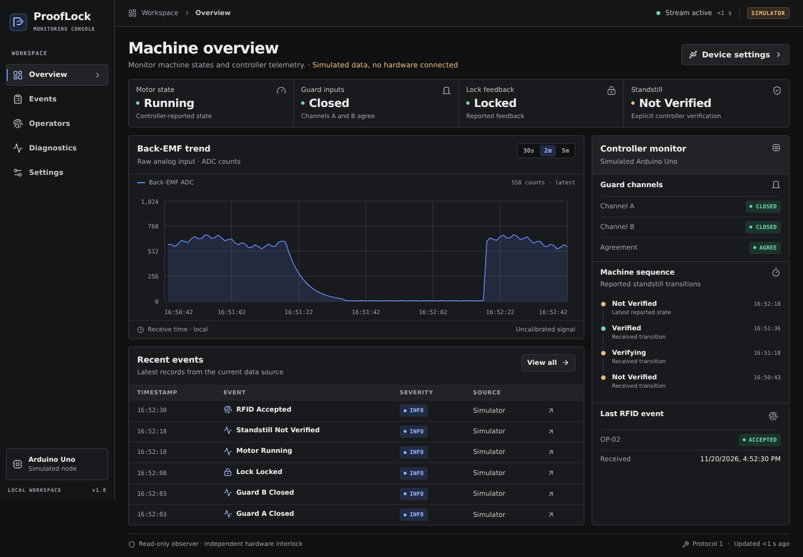

# ProofLock

**An RFID-gated machine control console for the ProofLock stop-verified guard prototype.**

ProofLock puts the operator in front of one machine: scan a card, start and stop the motor, and read the safety state the controller reports. The guard stays locked while the shaft turns and is released only after the board has verified standstill. Every accepted card is written to an attendance log.

Runs on the connected laptop without an account, internet connection, or cloud service.

[Quick start](#quick-start) · [Run locally](RUN-LOCALLY.md) · [Connect an Arduino](#connect-an-arduino) · [Serial contract](docs/protocol.md) · [Bench checklist](docs/test-plan.md) · [Project specification](ProofLock_Dashboard_PRD_and_Tech_Stack.pdf)



> [!IMPORTANT]
> **Bench prototype, not a certified safety system.** The guard release decision is made on the Arduino by the standstill circuit; the dashboard only displays it and cannot release the lock, override the interlock or change a threshold. Test on an appropriate low-energy bench setup only; do not use this prototype as the sole safeguard on machinery that can injure someone.

## What you can do

| Screen | Purpose |
| --- | --- |
| **Access gate** | The app opens locked. Scan a registered card at the reader to start a 15-minute session; a denied or unknown card keeps the machine controls unreachable. |
| **Machine** | Large **MOTOR ON** / **MOTOR OFF** with live state, the guard panel (`GUARD LOCKED`, `MOTOR STOPPING`, `SAFE TO OPEN`), the operator and system summary, and the attendance table with search and date filter. |
| **Diagnostics** | Link age, packet counts, rejected frames, fitted-sensor flags and the raw standstill signal for bench calibration. Deliberately kept off the operator screen. |

## How access works

1. The MFRC522 reader compares a card UID with the table stored **in the sketch**. The UID never leaves the board.
2. The board sends `ACCEPTED`/`DENIED` plus a short reference such as `OP-01`.
3. The service matches that reference against `config/operators.json`. A reference that is not registered is reported as **card not registered** and no session opens — a stale firmware table cannot unlock the console by itself.
4. A session lasts 15 minutes, ends on **Lock**, and is required for every command.

Without `config/operators.json` the console says so plainly, and every card is refused. Copy `config/operators.example.json` to `config/operators.json` and edit it; scan the cards to learn their references.

## How the machine responds

| Step | Console | Controller |
| --- | --- | --- |
| Start | Motor **RUNNING**, `GUARD LOCKED` | Relay on; the guard lock is held. |
| Stop | Motor **STOPPING**, `WAITING FOR THE MOTOR TO STOP` | Relay off; the guard stays locked while the shaft coasts. |
| Verified | **STOPPED**, `SAFE TO OPEN`, lock **RELEASED** | Comparator and divider agree for the settle window; the solenoid releases. |
| Fault | `SAFETY SYSTEM FAULT — DO NOT OPEN THE GUARD` | A fault de-energises both outputs and is never cleared by software. |

The console shows only these states — no voltages, waveforms or raw counts on the operator screen. If no guard switch or lock sensor is fitted the panel does **not** claim the guard is secure: it shows `UNKNOWN` and a standing "no guard interlock fitted" warning.

**The motor stops if this page does.** `MOTOR_ON` doubles as a run permit that must be refreshed about once a second; if the page closes, the laptop sleeps or the cable is pulled, the board cuts the relay and runs the normal stop sequence. A dashboard command can never release the lock.

## Quick start

**Prerequisites:** Python 3.11+ and Node.js 22 with npm. Internet access is needed to install dependencies; not to operate the built dashboard.

From the repository root, build the frontend:

```sh
npm --prefix frontend ci
npm --prefix frontend run build
```

Or double-click **`start-windows.bat`** (`./start-mac-linux.sh` on macOS/Linux): it creates the environment, installs packages, builds the console, creates `config/operators.json` from the example and opens the browser. A step-by-step Hindi/English walkthrough, including the Arduino link and troubleshooting, is in [`RUN-LOCALLY.md`](RUN-LOCALLY.md).

Otherwise choose the commands for your OS. Activation is not required.

**Windows PowerShell**

```powershell
py -3 -m venv .venv
.\.venv\Scripts\python.exe -m pip install -r backend/requirements.txt
.\.venv\Scripts\python.exe -m uvicorn backend.main:app --host 127.0.0.1 --port 8000
```

**macOS / Linux**

```sh
python3 -m venv .venv
.venv/bin/python -m pip install -r backend/requirements.txt
.venv/bin/python -m uvicorn backend.main:app --host 127.0.0.1 --port 8000
```

Copy `config/operators.example.json` to `config/operators.json` and open **<http://127.0.0.1:8000>**. Live mode starts disconnected, and the gate says so instead of pretending a reader is present.

To review the console without hardware, click **Start simulator** on the gate, then pick an operator in the **simulated reader** panel and press **Present card**. The simulator is always labelled **SIMULATOR** and shows **SIMULATED DATA** in the toolbar; its records never mix with live history. The Arena preview runs the same simulator and refuses every request that could touch a serial port.

## Connect an Arduino

The bench firmware, pin table, card enrolment steps, standstill calibration and upload troubleshooting are in [`firmware/README.md`](firmware/README.md).

1. Upload the bench firmware in [`firmware/prooflock_uno`](firmware/README.md), or confirm your own sketch speaks the [documented v1 protocol](docs/protocol.md) **and** accepts the two command frames. `115200` is the default baud in both places.
2. Close Arduino Serial Monitor or any other app using the port.
3. Click **Machine link**, refresh ports, select the Uno's port, and click **Connect**.
4. Scan a registered card. If the gate answers `ACCESS DENIED · card not registered`, add that reference to `config/operators.json`.
5. Check **Diagnostics** for valid packets, then start the motor from the console.

| Symptom | What to check |
| --- | --- |
| No port appears | Try a known data cable or another USB port. On Windows check Device Manager; on Linux check serial permissions. |
| Port busy or reconnecting | Close other serial tools; check the cable and whether the OS renamed the port. |
| Card scan does nothing | Confirm `readerReady` — the board sends `NOT_CONFIGURED` once if the MFRC522 is missing or miswired. Enrol the card in the sketch first. |
| Gate refuses a card the sketch accepts | The reference is not in `config/operators.json`, or the registry failed to load (the gate names the file). |
| MOTOR ON stays disabled | The panel explains why: guard open, lock released, safety fault, or stale feedback. The board refuses the command as well. |
| Page unavailable | Build `frontend/dist` before starting the service, and use a loopback port. |

## How it works

```text
MFRC522 ──▶ Arduino ──telemetry/rfid──▶ pySerial reader ──▶ session + safety state
                 ▲                                          ├──▶ SQLite events / attendance
                 └── MOTOR_ON / MOTOR_OFF (v1 frames) ◀─────┤
                                                            └──▶ FastAPI WS/REST ──▶ React console
```

- **Transport:** WebSocket streaming is preferred. The console falls back to polling the same status endpoint when a proxy blocks the socket.
- **Fail-closed:** a stale link, an unreported guard channel or an unknown lock state blocks a start. Missing data never becomes `STOPPED` or `VERIFIED`.
- **Attendance:** write-once rows (time, engineer, reference, result), newest first, searchable and filterable by date, stored in their own table and never derived from motor state.
- **Audit:** CSV timestamps are UTC; the UI renders local time. Every command, including refusals, is recorded.
- **Storage:** SQLite WAL data lives in `data/prooflock.sqlite3` and is ignored by Git. Set `PROOFLOCK_DB` to use another file.
- **Deployment:** one server worker on loopback. Do not expose the hardware-connected service publicly; the preview mode is simulator-only and blocks everything except simulated scans and motor commands against the simulator.

## Develop and verify

```sh
# Backend and firmware-contract checks (use .venv\Scripts\python.exe on Windows)
.venv/bin/python -m unittest discover -s backend/tests -v
.venv/bin/python -m unittest discover -s firmware/tests -v

# Frontend type-check and production build
npm --prefix frontend run build
```

The suite covers access gating, stale and disconnected feedback, the guard-release sequence, command refusals, run permits, malformed and oversized frames, and the real pySerial reader against a virtual port. For physical sign-off follow the [bench checklist](docs/test-plan.md); browser and virtual-port checks are not proof of electrical or firmware integration.
